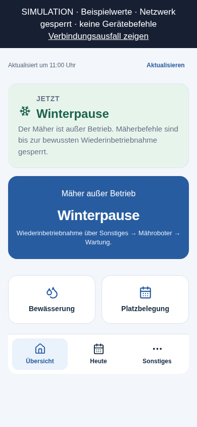
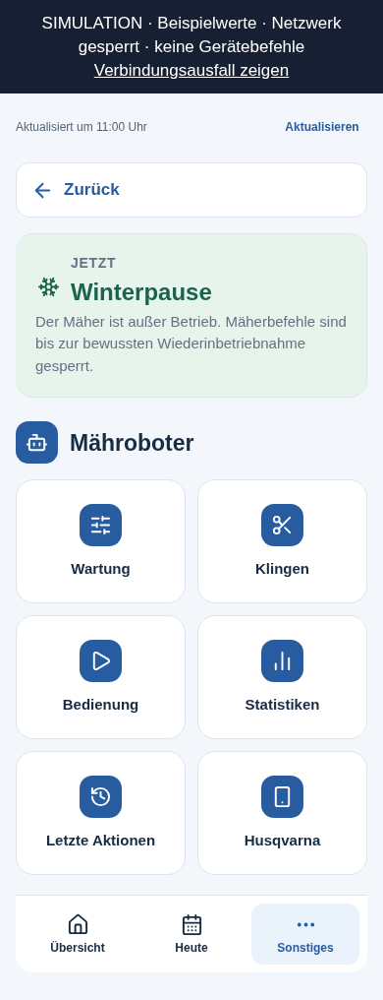
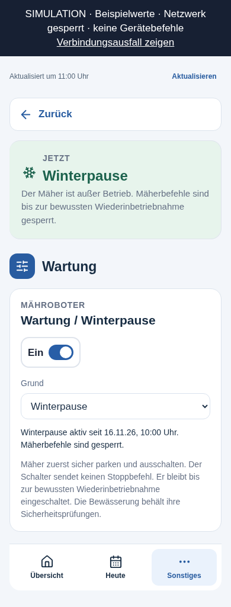
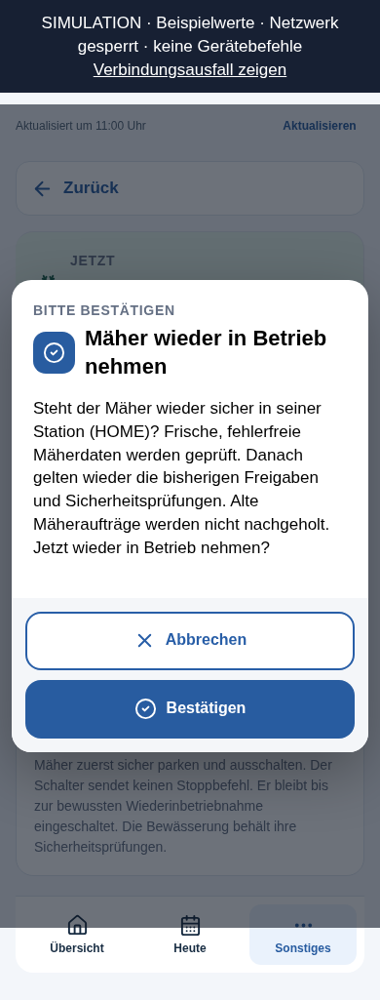

# Mäher: Wartung / Winterpause

Stand: 10.11.2026. Vollständig in Azure und Appack veröffentlicht.
Der Wartungsschalter ist aus (Stand 0); die Winterpause wurde nicht aktiviert.

## Bedienung

Unter **Platzpflege → Sonstiges → Mähroboter → Wartung → Wartung / Winterpause**:

Die Mähroboter-Seite zeigt den Menüpunkt **Wartung**. Der Schalter ist erst
auf dieser Unterseite sichtbar.

1. Den Mäher sicher parken und die Bestätigung abwarten. Vor der Einlagerung
   den Mäher vor Ort ausschalten. Der Wartungsschalter sendet keinen Stoppbefehl.
2. Als Grund **Winterpause**, **Wartung** oder **Defekt** wählen, den Schalter
   einschalten und die Nachfrage bestätigen.
3. Der Mäher bleibt dauerhaft außer Betrieb, auch nach App-Schließen oder einem
   Serverneustart. Die Übersicht zeigt den gewählten Grund anstelle einer
   Startprognose. Erwartete Offline-Meldungen erzeugen keine Mäherwarnung.
4. Zur Rückkehr den Mäher wieder in die Station bringen und eine frische,
   verbundene, fehlerfreie Meldung im Modus HOME abwarten. Dann den Schalter
   ausschalten und **Mäher wieder in Betrieb nehmen** bestätigen.

Die Wiederinbetriebnahme sendet selbst keinen Startbefehl. Danach gelten die
bisherigen Freigaben und Sicherheitsprüfungen; eine zuvor vorhandene manuelle
Parksperre bleibt bestehen. Es gibt kein automatisches Ende der Winterpause.

## Sicherheitsgrenzen

- Der bestehende allgemeine `maintenance_mode` bleibt unverändert. Der neue
  Mäherschalter hat eigene, persistente Felder in `MowerAutomationState`.
- Start, Parken, Schnitthöhe, Klingenzähler und manuelle Startvorbereitungen
  sind während der Pause gesperrt, auch bei alten App-Seiten. Die vorhandene
  Platzwart-Anmeldung schützt die neue Aktion; jede Änderung wird protokolliert.
- Ungesendete Mäheraufträge werden verworfen, START-Sitzungen beendet und
  ungenutzte Koordinierungsentwürfe aufgehoben. Versandbelege und unklare
  Transportergebnisse werden erhalten. Ein unbestätigter Start oder ein
  ungeklärter Gerätebefehl muss vor dem Umschalten geklärt werden.
- Die Umschaltung nutzt den bestehenden Compare-and-Swap-Speicher und einen
  eigenen Schalterstand. Doppelte Requests sind idempotent; veraltete Requests
  und späte Befehle nach einem zwischenzeitlichen Ein-/Ausschalten werden abgewiesen.
- Laufende Bewässerungsabläufe bzw. Wasserkonflikt-Transaktionen müssen vor
  dem Umschalten beendet sein. Der Schalter ändert keine Bewässerungspläne,
  Ventile, Trainingsschalter oder E-Mails. Bewässerungsstopps und deren
  Bestätigung funktionieren auch bei offline eingelagertem Mäher.
- Ein eingelagerter Mäher zählt **nicht** automatisch als sicher geparkt.
  Bewässerungsstarts benötigen weiterhin sämtliche bisherigen Nachweise.
  Fehlende Bewässerungsdaten und echte Störungen bleiben sichtbar. Ein frisch
  als fahrend gemeldeter Mäher erzeugt trotz Winterpause eine Warnung.

## Auslieferung und spätere Updates

Keine neue Azure-Funktion, App-Einstellung oder Datenmigration erforderlich.
Neue Zustandsfelder fehlen im bisherigen Zustand und sind standardmäßig aus.
Alle vier Paketbuilder enthalten das neue Modul `mower/service_mode.py`.
Backend und Appack-Vorlage müssen gemeinsam ausgeliefert werden. Eine alte
Backend-Version darf eine aktive Pause nicht verwalten: alte Zustandsmodelle
könnten die neuen Felder beim Schreiben verwerfen. Bestehende Live-Pakete und
CMS-Anpassungen sind bei einer späteren Veröffentlichung gezielt zu erhalten.

`scripts/deploy_mower_service.py` identifiziert das aktive Flex-Paket über
den bestätigten `ActiveDeploymentId` in der privaten `kudu-state.json`.
Es ergänzt ausschließlich die geprüften Steuerungsdateien und die
Payload-Weiterleitung. Bekannte, unabhängig weiterentwickelte Live-Dateien
werden anhand festgehaltener Hashes mit dem Wartungsdelta zusammengeführt;
überlappende Änderungen führen zum Abbruch. Die vollständigen Live-Snapshots
werden vor und nach der Ergänzung mit ihren bestehenden Bibliotheken geprüft.
Alle 42 Wartungsfälle müssen laufen und bestehen; neue Testfehler verhindern
die Bereitstellung. Einstellungen und Laufzeitdaten werden nicht geschrieben.

`scripts/merge_mower_service_cms.py` führt die Appack-Ergänzung im Speicher mit
der tatsächlich vorhandenen Vorlage zusammen. Die vorhandene Sichtbarkeits-
und Bedienlogik bleibt erhalten. In den Belegen stehen nur Hashes und
Prüfergebnisse, keine CMS-Quelltexte, Zugangsdaten oder Sitzungen.

## Prüfung und Vorschau

Die Python-Tests verbieten Netzwerkzugriffe. Die zusätzlichen Sicherheitsfälle
prüfen unter anderem parallele Updates, abgelaufene Bestätigungen, langsame
Authentifizierung, unklare Starts, verworfene Altaufträge, Offline-Winterpause
und Bewässerungsstopps samt physischer Abschlussbestätigung mit simulierten
Geräteantworten.

```sh
.venv/bin/python -m pytest -q
node --test tests/test_appack*.js
.venv/bin/python scripts/sync_platzpflege_design.py --check
.venv/bin/python -m scripts.build_mower_service_preview
python3 -m http.server 8765 --bind 127.0.0.1 --directory /tmp/ssv53-service-preview
```

Die Vorschau unter `http://127.0.0.1:8765/appack-preview.html` enthält ausschließlich
Beispieldaten und blockiert externe Netzwerkzugriffe per CSP. Mobile Prüfung
bei 320 und 390 Pixeln: kein horizontaler Überlauf, keine JavaScript-Fehler;
Abbrechen sowie Ein-/Ausschalten mit simulierten API-Antworten geprüft.






## Live-Abnahme

- [Erfolgreiche Abschlussprüfung](https://github.com/Rohdeo87/ssv53-heimspiele/actions/runs/42844491495): vollständiger Paketinhalt entspricht dem geprüften Merge, alle 20 vorhandenen Funktionen erhalten; Kalender, Anmeldung und SMTP ohne Mailversand geprüft.
- Alle 42 neuen Wartungsfälle bestehen. Im Vergleich der vollständigen Live-Snapshots bleiben 21 bereits vorher vorhandene Testfehler unverändert; es gibt keinen neuen Fehlerfall. Details: `azure-delivery-proof.json`.
- Das veröffentlichte Paket wurde anhand der tatsächlich protokollierten Entry-Point- und Manifest-Hashes identifiziert. Der laufende Worker bestätigt sein Manifest und schreibt den Wartungsschalter weiterhin als `false`, Stand `0`. Details: `runtime-after-delivery.json`.
- Die Flex-Datei `kudu-state.json` verweist noch auf das Vorgängerpaket. Der ursprüngliche Abschlussmonitor wartete deshalb vergeblich auf eine neue ID. Die separate Abschlussprüfung hat das tatsächlich laufende Paket vollständig zurückgelesen und mit dem geprüften Paket verglichen, ohne erneut auszuliefern. Ein späterer Deployment-Aufruf darf den veralteten Zeiger nicht ungeprüft als Basis verwenden; der neue Schutz bricht in diesem Fall ab.
- Appack-Vorlage nach Speichern neu geladen und Quelle verglichen; öffentlicher Renderer liefert HTTP 200 mit dem Menüpunkt **Wartung** und dem Schalter. Die 405 unabhängigen Änderungen der vorhandenen Vorlage wurden erhalten. Details: `cms-delivery-proof.json`.
- Keine echte Wartungsumschaltung, kein Mäherbefehl, kein Bewässerungsbefehl und keine Test-E-Mail zur Abnahme ausgelöst. Die Interaktionen wurden mit simulierten Antworten geprüft.
